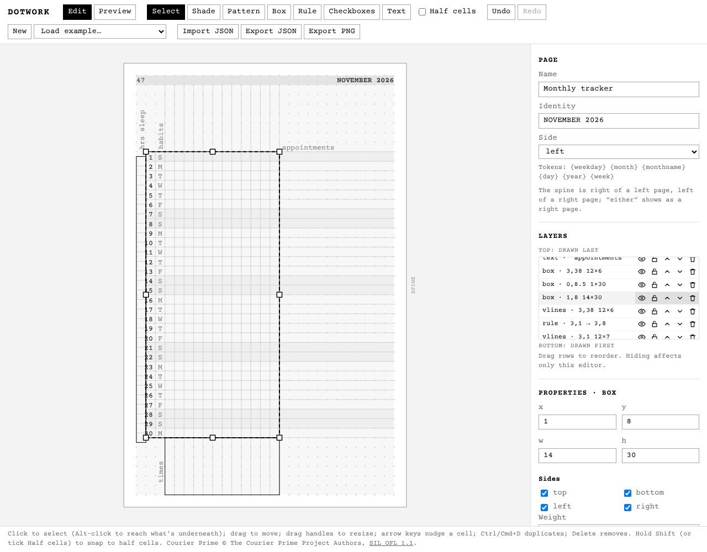
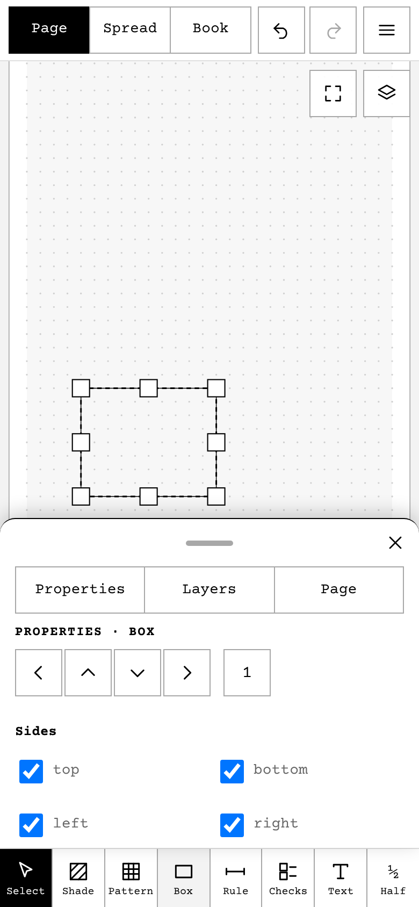
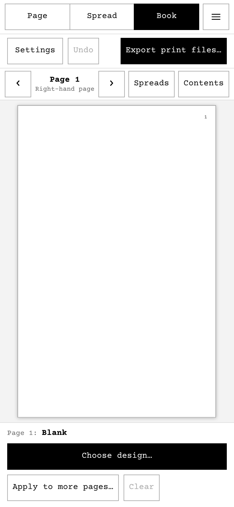
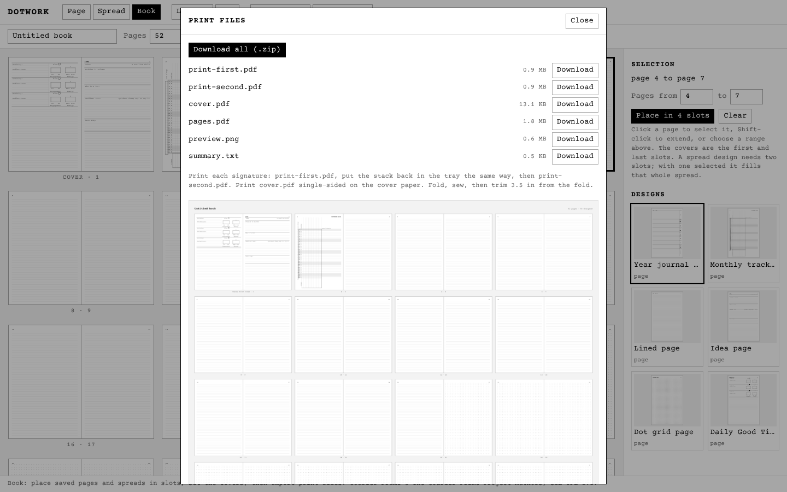

# Dotwork

Dotwork is a small browser editor for designing the pages of a pocket
notebook. A page is 3.5" x 5.5" (88.9 x 139.7 mm) with a 27 x 44 grid of 3 mm
cells centered on it; the space around the grid is the margin and nothing prints
there. You build a page from layered elements (pattern, shade, box, rule,
checkboxes, text, sequence) placed on whole or half cells, and save it as a JSON page
file, described in [docs/page-format.md](docs/page-format.md) (version 2).
Row 0 is reserved for the page header: the page number at the outer corner and
the identity by the spine. Version 1 files are converted when imported.



## Using the editor

- **The bottom bar** has three fixed modes, **Select**, **Draw** and **Advanced**, and five buttons beside them that
  follow the mode and the selection. Draw: Pattern, Shade, Box, Rule, Text. Advanced: Sequence, Icon, Checks, Widgets.
  Select with nothing selected: Select all and Half; with something selected: Props, Copy, Delete, Group/Ungroup and More
  (bring forward, send backward, select underneath, save as widget, half cells). Keys: V, A, P, S, B, R, C, T.
- **Select** by tapping: the nearest element within about 6 mm is picked, so thin rules and small text are easy. Drag on
  empty space to draw a box that selects everything it touches; two fingers pan and pinch zooms. With a mouse, click, drag
  a box, Shift-click to add, Alt-click to step down, arrow keys nudge, Ctrl/Cmd+D duplicates, Ctrl/Cmd+Z undoes.
- **Properties** slide up from the bottom bar (the Props button, or a double-tap) and the page scrolls so the selection
  stays above them. A value that would break the format is refused, with the reason.
- **Groups**: an element can have a `group`. Tapping any part of a group selects all of it, and it moves as one. Group and
  Ungroup are in the bar. A placed widget is a group. Double-tap a group to edit inside it (the rest dims and a banner says
  so); tap outside, or Done, to leave.
- **Shade** tints an area with tones that repeat: letters L, M, D, B (light, medium, dark, blank) along rows, columns or as
  a checker, each step covering `every` cells; the properties show a strip that previews it as you type.
- **Pattern** draws writing lines, vertical lines, a grid or dots; lines come in hair (default), thin or thick, dots in
  small or large, and "include the first edge" adds the top (or left) line.
- **Advanced** places a **Sequence**, an **Icon** (about 60 line icons from a big tappable grid), **Checks**, or one of your
  **Widgets**. Save a selection from More; widgets are kept in the browser, beside the library.
- **Layers** lists every element from top (drawn last) to bottom. Tap a name to select that element and open its
  properties. Hide, lock, delete, and reorder with the arrows or by dragging a row. Hiding and locking are for editing
  only; they are not saved in the file.
- **Properties** shows every field of the selected element. A value that would
  break the format is refused, with the reason.
- **The top bar** has three buttons. **Page ▾** switches between Page, Spread and Book (its label shows which one you are
  in) and opens **Settings**. **Edit ▾** holds Edit, Preview, Library and New. **Export** opens the import and export
  window. Undo, redo and help are icons on the right. A menu closes when you choose an item or tap outside it.
- **Settings** (Page ▾, then Settings) holds the name and settings of what you are editing. For a page: its name, whether
  the page number prints, the identity (optional text by the spine, with tokens such as `{weekday}`; the field starts empty
  with an example in gray) and the side. **Row 0 is the header row**: while the page has an identity it belongs to the
  header; leave the identity empty and you can draw in row 0, except the page number's two corner cells while the page
  number is on. A spread's settings cover its name and both pages; a book's cover its name, page count, page numbers and the
  print settings.
- **Library** (Edit ▾, then Library) is a browser with a search box and tabs for Pages, Spreads, Books, Widgets and
  Favorites. Tap the star on anything to find it under Favorites. It comes filled: every page of the owner's books,
  spreads (lined, dot grid and notes, two of the same page; ideas; book notes; weekly, dated and undated, mirrored so the day column is on the outer edge of both pages; and each book's covers), starter widgets, and book templates, all marked
  as examples. An example can't be changed: opening or placing one gives an editable copy named “… copy”, and a saved
  item can't take an example's name. Tap an item to open or place it; Rename, Duplicate and Delete are in the ⋯ menu on
  each saved one.
- **Book templates** (Library, Books tab) ask a few questions, then build a complete dated 52-page book you can edit
  and export: *Year planner* (year and first and last week), *Monthly journal* (year and month), and Blank, Lined,
  Dot grid and Idea books. They are small functions in `src/builtin/`, not files, because dates and month layouts change.
- **Export** is one window with four tabs. **Import** opens a JSON file. **Export** saves the current page, spread or book as
  JSON. **PNG** saves the page or spread at 150, 300 or 600 DPI. **PDF** makes the book's pages at final size, or
  print-ready signatures, with or without the covers. Each tab says what file you get, and nothing downloads until you
  press its **Download** button.

## On a phone or tablet

The same app is laid out for touch below 1000 px wide: a one-row top bar (the
Page, Edit and Export buttons, with Undo, Redo and Help as icons), the page filling
the screen, and the tools along the bottom (including a **Half** toggle that replaces
holding Shift).



- **Pinch** to zoom, **two fingers** to pan, the **Fit** button to bring the
  whole page back.
- Selecting an element opens the **bottom sheet** (properties with nudge arrows
  for a cell or half a cell; a tab for Layers). Pull the grip up or
  swipe it down; the page scrolls so the selection never hides under it.
- **Long-press** an element for duplicate, delete, bring forward, send backward
  and select the one underneath. Resize handles are finger-sized.
- **Spread** edits one page at a time (Left / Right, or swipe over an empty
  part of the page); **View spread** shows the pair as it will look open.
- The Library, Settings and Export windows are full-screen sheets on a phone; the signature PDFs
  download as one zip.
- A web app manifest and icon let you add Dotwork to the home screen.

Screenshots for phone, tablet and desktop are in
[docs/screenshots/mobile/](docs/screenshots/mobile/).

## Run locally

```sh
npm install
npm run dev      # editor at http://localhost:5173
npm test         # validator, conversion, geometry, history, rendering, imposition and PDF tests
npm run build    # type-checks, then builds to dist/
npm run test:e2e # drives the app in headless Chromium at phone, tablet and desktop sizes
```

The current page autosaves to your browser's localStorage. Use the Export button for
JSON, PNG (the whole 88.9 x 139.7 mm page, 600 DPI by default) and PDF.
Built-in pages live in [src/builtin/](src/builtin/) (pages that depend on a date are drawn in code) and
[examples/](examples/) (plain page files), and show in the Library; they recreate journal-system's pages. Compare
them with `reference/` in [docs/screenshots/](docs/screenshots/)
(`compare-*.png`: reference on the left, Dotwork's export on the right).

## Books and print files

The **Book** view arranges a book (52 pages by default; the count is a setting,
rounded to a multiple of 4) as spreads, the way it opens: the inside front cover
beside page 1, pages 2 and 3, and so on to the last page beside the inside back
cover.



- The book is shown **one page at a time**, large. Use the arrows (or swipe, or
  the arrow keys) to step through the inside front cover, pages 1 to N and the
  inside back cover. **Spreads** shows the current opening side by side; tap a
  page in it to pick that page.
- **Choose design…** opens a picker of large, named thumbnails in two tabs. **Pages** has Blank, then your saved pages and the
  built-in pages under their own headings. **Spreads** (on a left page only: a spread fills this page and the next) has your
  saved spreads and the built-in ones. The picker opens on the tab you used last. Choosing a design places it on this page.
  If a page has something in the page number's corner and is put on the other side of the spine, its page number is turned
  off on that copy (the app says so). The inside covers never print a page number.
- **Apply to more pages…** copies this page's design to pages __ to __, every
  page from here to __, or every left or right page in a range. It lists the
  pages that will change before you apply. If the facing page has a design, **Copy the facing page too** repeats the pair as
  a spread (left pages get the left one, right pages the right one). **Clear** blanks this page and
  **Undo** steps back.
- **Contents** lists every page with its design and a thumbnail; tap a row to
  jump there. Runs of the same design fold into one row ("Pages 5–30") that
  expands on tap. On a phone it opens from the **Contents** button.
- **Page numbers** are on by default, in each page's outer top corner. Date
  tokens (`{weekday}` and so on) print blank so the date can be written in.
- **Book settings** (Page ▾, then Settings, and again in the PDF tab): paper thickness for creep (0.14 mm), the **front
  and back offsets** (x and y; each side's own error against the paper, so the fold lands on the sheet's centre and the
  margins are even), the number of signatures, and four **tones**: how dark
  the printed PDFs draw the light, medium and dark shade and the gray text, as a percent of black (the editor and PNGs
  keep their fixed grays). A creep that would cross the fold is refused with the reason.
- **Calibrate your printer…** (PDF tab) opens a three-step wizard, one step on screen at a time, with Back and Next:
  1. **Alignment** downloads `calibration-alignment.pdf` (page 1 the front, page 2 the back). Fold the printed sheet in half edge to edge
     and read where the crease crosses each side's fold scale, then read the margin where the paper ends on the top and
     bottom rulers. The wizard turns the readings into the four offsets.
  2. **Creep and cover** downloads a zip with `creep-test.pdf` (every sheet of your biggest signature, both sides, in
     manual-duplex order) and `calibration-cover.pdf`, both with margin rulers on every page. After binding and
     trimming, read the fore-edge margin on the cover, the outermost sheet and the innermost sheet; the wizard gives the
     new paper thickness (and how far the cover's own thickness pushes the pages in).
  3. **Check** (optional) prints the corrected creep test again and compares the margins you measure with the targets
     (3.95 mm at the fore-edge, 3.85 mm top and bottom); it also holds the tone fields.

  Everything you enter there is also kept in the browser as **your printer's settings**: new books start from them, and the
  PDF tab says when a book's settings differ, with **Use my printer settings** and **Keep this book's**. The book still
  carries its own copy in `book.json`. What the sheets contain and how to read them is in [docs/book-format.md](docs/book-format.md).
- **Print files…** (or Export, then PDF) offers **pages at final size** (`pages.pdf`) or **print-ready signatures**
  (`print-first.pdf` and `print-second.pdf`, one pair per signature, with a `preview.png` contact sheet and a
  `summary.txt` in the zip, which lists the print settings that made the files and short printing tips), and **cover.pdf** with either. It always downloads as a zip, with `book.json` (the book it was built from) and, if anything failed, an `error.txt`.
  If the book breaks the book format the PDFs are still made, and the screen and `error.txt` say why. After every change the
  Book view checks the book and shows the reason, with Copy details, if it breaks. A draft the app can't read is never deleted: it is kept under a backup name in the browser and offered as a download.
  Text stays real text in the embedded Courier Prime and lines stay vector.



A book is saved to the Library beside pages and spreads, and Export's **Export** and **Import** tabs
read and write it as a JSON file; the format and the print files are
described in [docs/book-format.md](docs/book-format.md). The imposition is a
port of journal-system's `pocketjournal/imposition.py`, tested with the same
cases. Print each signature the way it says in `summary.txt`: `print-first.pdf`,
put the stack back in the tray the same way, then `print-second.pdf`.

## Deploy

Every push to `main` runs `.github/workflows/deploy.yml`, which tests, builds
and publishes `dist/` to GitHub Pages. One-time setup: in the repository's
Settings > Pages, set Source to "GitHub Actions". The build uses relative
paths, so it works under `https://<user>.github.io/<repo>/`.

## Fonts

Courier Prime (regular and bold) is bundled in `src/fonts/` under the SIL Open
Font License 1.1; see `src/fonts/OFL.txt`.
