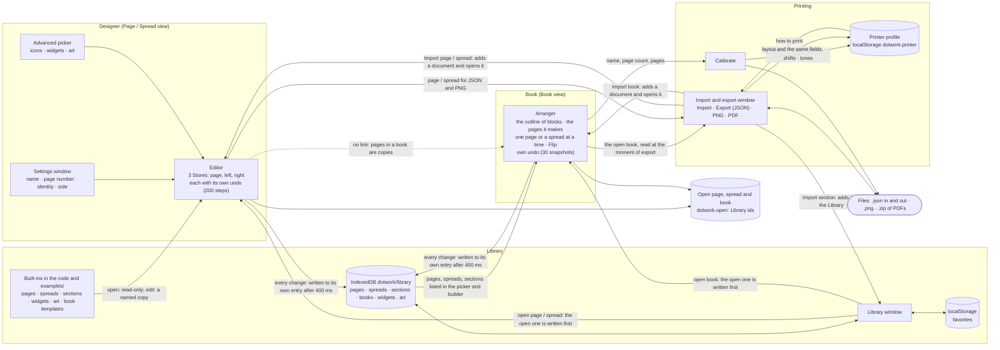

# Dotwork product map: how the app works today

This describes what the code does now (with phases 1 to 3, 4 and 5a of [product-model.md](product-model.md) applied: pages,
spreads and books are Library documents that save themselves, and a book is an outline of blocks), read from `src/`, not from the other docs or from comments. Where the code and a doc disagree, the code wins and the disagreement is listed in **Things that disagree** at the end.
Anything I could not confirm from the code is marked **(unsure)**.

The owner's examples, `tests/fixtures/monthly-log-book.json` and `november-2026-journal.json`, are books in the old format (a `pages` list with `dates`): they can no longer be opened, and the Old format test uses one of them. The findings about the first are kept at the end of section 4 as history.

## 1. The parts, in one picture

The one rule that holds everywhere: **everything is copied; a link is recorded but not followed.** A block in a book holds a copy of
the design it was placed from, with a `from` (the design's id and a fingerprint of it) that nothing reads yet. A spread holds two copies.
A section holds copies. A widget placed on a page becomes ordinary elements. The only references in the app are Library ids (favorites,
the "Bottom book" choice in the PDF tab, and the `from` links) and the names of built-ins.

## 2. Things the app stores

| Thing | What it holds | Where it is kept | How it refers to others |
|---|---|---|---|
| **Page** (`dotwork-page`, version 2) | `name`, `identity` (the header text, may hold tokens), `page_number` (default on), `side` (`left` / `right` / `either`), `mirror_left` (default off: drawn flipped on a left page, `src/format/mirror.ts`; the editor shows the stored design, Preview and every export the mirrored one; on for the Week planner), the 27 × 44 grid, `elements[]` (pattern, shade, box, rule, checkboxes, text, sequence, art; each may carry a `group` id). `src/format/types.ts` | Library: kind `page`; the open page is one of these entries (its `name` is the entry's, put into the file when it is exported). Inside spreads, books, sections. | Copy everywhere. |
| **Spread** (`dotwork-spread`, v2) | `name`, a `left` page and a `right` page (each must carry the matching `side`). `src/format/spread.ts` | Library: kind `spread`; the open spread is one of these entries. The two pages are the editor's two Stores; the spread object is built when written or exported (`currentSpread()` in `main.ts`). | Two embedded copies. |
| **Book** (`dotwork-book`, v1) | `name`, `page_count` (multiple of 4, 4–400), `page_numbers`, `print: { signatures }`, `outline[]` (blocks: page, spread, free pages or group, each with a repeat and, at the top level, an optional pin), `cover` (`front` = inside front, `back` = inside back, optional `outside_front`, `outside_back`). The pages it prints are worked out from the outline by `layoutOutline` (`src/book/outline.ts`, `bookLayout` in `book.ts`). `src/book/book.ts`, `outlineread.ts` | Library: kind `book`; the open book is one of these entries (its `name` is the entry's, put into the file when it is exported). | Embedded copies of every page and cover, each block with a `from` link (recorded only). |
| **Section** (`dotwork-section`, v1) | `name`, `children[]`: the blocks of a group (page, spread and free blocks, each repeating a number of times). Placing one in a book adds a group. `src/book/sections.ts` | Library: kind `section`. Built-ins in code (`src/builtin/sections.ts`). | Embedded page copies. |
| **Widget** | `{ id, name, elements[] }`, positions relative to its top-left. `src/widgets.ts` | Library: kind `widget`; the entry's `id` is the widget's id, `data` is `{ elements }` (name in the entry). `WidgetStore` keeps the list in memory for the pickers. Built-ins from `examples/widgets/*.json` (`src/builtin/widgets.ts`). | Placing it adds ordinary copies; no link back. |
| **Art** | A widget holding one `art` element (an imported SVG: shapes and colors). `src/art/` | Library: kind `art` (otherwise as widgets). Built-ins from `examples/art/*.svg` plus presets. | Same. |
| **Library entry** | `{ id (uuid), kind, name, updated, data }`. The name lives only in the entry, for every kind: `data.name` is left out when it is written and put back when it is read (an older entry that still has one loses it the next time it is written). `src/library/library.ts` | IndexedDB database `dotwork`, store `library` (`src/library/idb.ts`, one connection kept open). The backend is a `Keeper` (`src/library/keeper.ts`): with no IndexedDB, a database that refuses to open, or a first write that fails, it carries on from memory (lost on reload) and the notice at the top says so (D7). | The open page, spread and book *are* their entries, written in place. Names are unique per kind (a taken name gets ` 2`, ` 3`…, built-in names count as taken). A section is a document without an editor: imported, restored or duplicated, always as a new entry (no control saves a group as a section yet). A book or section from before the outline is listed as **Old format** (`isOldFormat`): Export and Delete only. |
| **The open documents** | The id of the open page, spread and book (a built-in page or spread by its example id; a built-in book, such as a template's, is not remembered, so the last saved book comes back). `src/documents.ts`, `main.ts` | `localStorage` `dotwork.open` (`{ "page": …, "spread": …, "book": … }`), read at start-up so a reload reopens them; one open document per view (Page, Spread, Book) until the three areas of the product model arrive. | By Library id. |
| **Library backup** (`dotwork-library`, v1) | Every Library entry (pages, spreads, books, sections, widgets, art), the favorites, and the printer profile (both layouts). `src/library/backup.ts`. | A downloaded file (**Back up library** / **Restore backup**). | Restore only adds (same id and content: skipped; same id, different content: added as `<name> (from backup)`; favorites merged; the printer profile is offered, default No). Nothing is replaced or deleted. |
| **Printer profile** | creep per sheet, fore-edge shift, cover shift, target margin, the four tones, `sheet_layout`, and per layout: front/back offsets, back rotation, x/y scale, line weight. `src/printer.ts`, `src/book/impose.ts` | `localStorage` `dotwork.printer`. Loaded once at start-up into a module variable in `main.ts`. Defaults (`DEFAULT_PRINT`) are the owner's printer. | Never in a book. `summary.txt` and calibration pages record the values used. |
| **Old drafts** | None any more. The page, spread and book drafts (`dotwork.page`, `dotwork.spread.left/right/name`, `dotwork.book`) are no longer read or written; anything left under those keys stays untouched. (`src/drafts.ts` is now used only for the printer profile.) | | n/a |
| **Favorites** | Starred Library item ids. | `localStorage` `dotwork.favorites`. | By Library id; built-ins by name (`example:<page name>`, `template:<id>` …). |
| **Book templates** | Functions that build a whole book, as an outline with its covers, from a few numbers (year, month, first and last week). | Code only (`src/builtin/templates.ts`). Not saved; the result is just a book. | Output is a copy. |
| **View settings** | `dotwork.view` (page / spread / book), `dotwork.book.spreads` (one page or two), `dotwork.book.picker-tab` (Pages, Spreads or Other), `dotwork.book.flip-ms`, `dotwork.view.contrast` (Darker grays on screen: on unless `0`; `src/contrast.ts`). | `localStorage`. | n/a |
| **Memory only** (lost on reload) | Undo stacks, selection, hidden/locked layers, current tool and mode, which spread page is active, the Book view's current page, every window's unsaved choices (PDF checkboxes, PNG resolution and Darker grays, "Bottom book", Calibrate readings, which outline row is selected or open). | | |

**Files the app makes:** page / spread / book JSON, PNG (page or spread), and a zip of PDFs
(`<book>-print.zip`: `pages.pdf`, `cover-outside.pdf`, `cover-inside.pdf`, per-signature `print-first.pdf` / `print-second.pdf`
(and `print-duplex.pdf` for two-up), `preview.png`, `summary.txt`, `book.json`, and `error.txt` only on a problem). Calibration
downloads (`calibration-sheet.pdf`, a creep-test zip) also carry `book.json`.

## 3. Every screen, window and menu

Top bar: **Page ▾** (Page, Spread, Book, Settings…), **Edit ▾** (Edit, Preview, Library…, New, and the checkbox item **Darker grays on screen**: a gray-to-gray SVG filter, `body.contrast`, on every on-screen page drawing: editors, Book view stage, Flip through and thumbnails; markup, PDFs and printer settings are untouched), **Export**, Undo, Redo, Help.
Page/Spread views also have the bottom tool bar (Select, Draw, Advanced) and the properties drawer / layers.

| Screen | Reads | Writes | When it saves |
|---|---|---|---|
| **Document bar** (under the top bar, in every view) | The open document's name, save status and whether it is a built-in (`DocSession`, `src/documents.ts`) | The name button renames in place (`DocSession.rename`); **Retry** after a failed write; **Edit a copy** on a built-in | Name: on Enter or when the field loses focus. The name shows **Untitled: name it** as a chip while the name is `Untitled`, `Untitled 2`…; the mark says **Saved**, **Saving…** or **Not saved** (with Retry, and a notice that has the real reason and Copy details). It says Saved only after a write that worked with nothing changed since. A built-in shows the quiet bar "Built-in. Editing makes a copy." When the browser can't keep documents, a warning above the bar says so (with an **Export…** button, and the top-bar Export button turns dark) and the mark says **Not saved**, never Saved, with no Retry. |
| **Page view** (editor) | The open page document (`dotwork.open` → Library) at start; Store | Store → its Library entry | Every committed change is written 400 ms after the last one, and at once when the tab is hidden (`visibilitychange`) or closed (`pagehide`). Typing in a properties text field commits after a pause or on blur (`panel.ts`). Undo history, selection, hidden/locked are not saved; undo is in memory for the open document and starts empty when another is opened. A change to a built-in is not made: a name is asked for, the copy is created, and the change is made in it (`Store.guard`). |
| **Spread view** | The open spread document | The two Stores → one spread entry; the name is the entry's | Same. Left and right each have their own undo. |
| **Properties / Layers** (drawer or side panel) | The selected element(s) | Store (undoable) | Same as above. |
| **Advanced** (sequence, icon, checkboxes, widgets, art) | Library-side widgets and built-ins | Arms a tool on all three Stores; **More → Save as widget** adds a Library document of kind `widget` | Widgets: immediately (a Library write). |
| **Settings…** | Page: `store.page` and the document's name. Spread: the document's name + both pages (which keep names of their own inside the spread). Book: the book | Page/spread: Store commits (undoable, coalesced per field); the name renames the document (not a Store commit). Book: `arranger.edit()` → the open book document; the book's name renames the document (not an undo step) | On each input event (`oninput`), not on Done. A built-in's name is read-only. |
| **Library…** (window) | IndexedDB entries (including widgets and art); built-ins; favorites | rename, delete → IndexedDB (nothing is saved by hand: there is no Save button); **Duplicate** of a page, spread, book or section, built-in or saved, asks for a name (prefilled `<name> copy`) and adds a document; **Export** (a section, or any book or section in the old format) downloads the file; star → favorites; Import SVG art → a Library document of kind `art`; Back up / Restore → file (Restore ends with a summary, and asks about the printer profile when the backup's differs) | Only when a button is pressed. Opening a page, spread or book writes the open one first and switches (nothing is replaced); opening a built-in, or a book built from a template that takes no options, is read-only. A template that asks for a year or month makes a new Library book at once (named from the template, ` 2` if taken), editable and autosaving. A section can't be opened (there is no section editor): tapping it says how to use it (Add… in the Book view). A book or section in the old format shows **Old format** and can't be opened either: tapping it says why, and its menu has only Export and Delete. Deleting the open document starts a new one. Tabs: Pages, Spreads, Sections, Art, Books (templates + saved books), Widgets, Favorites. It opens on Pages (or Books in the Book view). |
| **Book view** (Arranger) | The open book document (`dotwork.open` → Library, opened the first time the view is shown; an old-format book there is skipped and a new book starts); Library pages / spreads / sections (refreshed when shown and when the Library closes); built-in pages, spreads and sections; printer profile (only to warn) | The book, via `edit()` → its Library entry | After every change, one undo snapshot each, and the book is written 400 ms after the last change and when the tab is hidden or closed, as for pages. A change to a built-in book is not made: a name is asked for, the copy is created, and the change is made in it (`ArrangerHost.editing`). Slot, Spreads toggle: `dotwork.book.spreads` for the toggle, the slot is memory only. The page (or two pages) being looked at sits above the live total "N of 52 pages" (red, with **Make the book N pages**, when the outline is over); **Print files…** waits while the book is over. |
| **Outline** (beside the page on a desktop; a full-screen sheet on a phone, opened by **Outline**) | The book's outline and the layout worked out from it: one row per block (thumbnail, name, repeat, pages used, page range, pin), a dim row for each run of gap pages, rows inside a group, and the four covers at the ends | Each row: **Up** / **Down**, and **⋯** which opens its settings: repeat (− / number / +), **Fill what's left**, **Pin to page** (Not pinned / Page + number / Last page), **Duplicate**, **Delete**, a group's name and **Add to this group…**, **Move into a group…**, **Move out of the group**. All through `edit()`, one undo step each. | As the Book view. Tapping a row goes to its first page (and closes the sheet on a phone). |
| **Add…** (picker) | Tabs Pages (saved, built-in), Spreads (saved, built-in), Other (Blank page, Free pages, New group, saved and built-in sections) | Appends a block to the end of the outline, or of the group it was opened from with **Add to this group…**; a page or spread records its `from` (Library id, or `example:<name>`, and a fingerprint) | On choosing. A saved page or spread that is still `Untitled…` is named first (a small window; its Library name changes). Free pages are offered only when nothing else takes what is left. |
| **Choose design…** (covers only) | Blank, saved pages, built-in pages | `setCover` on the book | On choosing. The pages inside come from the outline, so there is no per-page design. |
| **Flip through** | The book (read-only). Speed from `dotwork.book.flip-ms` | Speed | On slider input. |
| **Import and export** window (**Export** button) | See below | See below | See below. Opens on Export; opens on PDF in the Book view. |
| ↳ **Import** | A chosen `.json` | A page, spread or book is added as a new document named from the file (` 2` if taken) and opened, after the open one is written; a section is added to the Library (nothing opens). Nothing is replaced. A library backup is refused with a pointer to Restore backup. | Immediately. |
| ↳ **Export** | The open page / spread / book **at the moment Download is pressed** (`jsonToExport()` in `main.ts` runs again on click), whether or not the 400 ms write has happened | A `.json` download. Before the first export (JSON, or the print zip on the PDF tab) of a page, spread or book that is still `Untitled…`, a small window asks for a name (leaving the field empty keeps it; cancelling cancels the export). | On Download. |
| ↳ **PNG** | The page (or the spread being edited) | A `.png` (150 / 300 / 600 dpi), with the same name question. Tick **Darker grays (for screens)** (off by default, memory only) to apply the same gray curve to the PNG's pixels; off is exactly the page. Not in the Book view. Prints with sample values: the sample date (Mon Oct 26 2026) for tokens and a sample page number "47" (`SAMPLE_DATE`, `SAMPLE_PAGE_NUMBER`); the tab says so in one line | On Download. |
| ↳ **PDF** (with **Reset this layout to defaults**: shows the layout's values beside the defaults, then confirms) | The book, printer profile, Library books (Bottom book) | A zip. Its fields write the printer profile (`dotwork.printer`) and the book's signatures (the open book) as they are changed | Fields: on change. Files: on Download. |
| **Calibrate** (from the PDF tab) | Book (name, page count; included as `book.json` in downloads), printer profile | The printer profile only, each time a field or a "Use" button changes it. Never the book. | Immediately; typed readings are memory only. Closing returns to the PDF tab. |
| **Help mode** | `src/help.ts` (one entry per `data-help` key, touch and desktop text) | Nothing | n/a |
| **Notices** | Problems (can't export, a page, spread or book that is not saved, a printer profile that can't be read) | Nothing | n/a |
| **Can't-keep warning** | `Keeper.keeping` | Nothing | Shown at the top for as long as the browser can't keep documents. |

Keyboard shortcuts (page and spread views only; the Book view has none except ←/→ for the page): V, A, P, S, B, R, C, T, Ctrl/Cmd+Z/Y/D, arrows, Delete, Escape.

## 4. Dates end to end

**Dates come from the calendar (phase 6).** The book stores an outline and an optional `calendar` (`start`, `end`, `week_starts`; set in Book
settings → Calendar). `layoutOutline(outline, count, calendar)` gives every placed page a `read` (a day, week or month of the calendar, from the
block's own repeat: `each day / week / month`, or `each day / week of the span` inside a group), and every print and preview path calls
`bookExpand(book, slot)`, which expands tokens by that reading. A book with no calendar, a gap page, the covers and a page that reads nothing
print every token blank (`blankTokens`). The outline rows say `reads: …` for the first repeat; adding a page suggests its repeat from its tokens
(`suggestUnit`); free pages hold designs (chosen on the page, stored in the block's `pages`) that survive a new calendar, and ones that no longer
fit are kept and marked "doesn't fit".

**Where a date still comes from.** The sample date `2026-10-26` (`SAMPLE_DATE`) is what every editor view, Library thumbnail, PNG,
and the Page view's Preview show tokens as. Nothing else supplies a date to a book. Templates build outlines; the reflection pages they
use carry tokens (`WEEK {week}  …`) or, for the monthly journal, literal week text (`WEEK 44  OCT 25-31`) written by the template.

**How tokens read a date.** `{weekday} {month} {monthname} {day} {year} {week} {months}` (`src/format/tokens.ts`, `dates.ts`). Weeks run Sunday–Saturday and week 1 holds January 1.

**What an offset means** (phase 4, D15). `{name+N}` / `{name-N}` counts in the token's own unit: days for `{day}` and `{weekday}`, weeks for `{week}`, months for `{month}` and `{monthname}`, years for `{year}`. A month or year offset keeps the day of the month where it can (Jan 31 + 1 month is in February; Feb 29 + 1 year is Feb 28). `{months}` is a separate token (the month, or "NOV / DEC" when the 7 days from the date reach the next month) and its offset still counts days. **What a page covers** (`pageKind`, until the calendar of phase 6): a *week page* if its tokens include `{week}`, any `@end`, or a day offset (on `{day}`, `{weekday}`, `{months}`) of 6 or more; otherwise a *day page*. A week page reads the week holding its date (Sunday start): `{weekday} {day} {month} {year}` are the week's first day, `{day+6}` its last; a day page reads its date. **`@end`** (`{month@end} {day@end}`) reads the last day of what the page covers (a week page's Saturday, a day page's own day); an offset with it is refused by `readPage` with the reason.

**The week block** (phase 7, `src/format/week.ts`). A `generated` element of kind `week`: goals, one day widget per day of the page's week inside the calendar, outcomes; each weekday keeps its full-week row and the missing days become lined space (see `page-format.md`). A page holding one is a week page. Tokens in a day row read that row's own day, and any element may be limited to weekends or weekdays (`days`). The built-in widgets Week goals / Week day / Week outcomes, the page Week planner and the Monthly log template use it; the editor previews a full, first or last week.

**What happens when…**

- **Blocks move or repeat.** Nothing about a date follows a block: the pages print blank wherever the layout puts them.
- **The book is resized** (Settings → Pages): `page_count` changes and the outline is kept; the layout is worked out again, a fill or free-pages block takes more or fewer pages, and a book the outline no longer fits is **over** (the count turns red, Print files waits).
- **Old books.** A book that stored `dates` and a `recipe` is not read: it is listed as Old format. The two fixtures in `tests/fixtures/` are such books. What the first one showed about the old builder (the recipe's month and the dates were stored apart, the Dates window defaulted to weeks) is why dates now come from each block's own repeat in the model (D13).

## 5. Saving and export

- **Autosave.** The open page, spread and book are Library entries and every committed change is written to them, 400 ms after the last change and at once when the tab is hidden or closed (`DocSession` / `Autosave` in `src/documents.ts`). There is no Save button and no unsaved state; the mark beside the name says **Saved** only after a write that worked and nothing has changed since, and **Not saved** with Retry (and the browser's real error, with Copy details) when a write fails. Switching documents writes the current one first and does not switch if that fails. If the browser can't keep documents at all (no IndexedDB, private mode, or a first write that fails) the warning at the top says so, the app works from memory and the mark says Not saved. An Untitled page, spread or book that was never drawn on is deleted when another document is opened or the tab is closed; named or edited documents are never deleted by the app.
- **No explicit save.** Nothing is saved by hand. Names are trimmed; an empty name becomes `Untitled`.
- **Opening.** A page, spread or book from the Library, or an import, switches to that document; nothing is replaced (the one open was written first, and is in the Library). A built-in opens read-only, and so does a book made from a template. **New** makes a page, spread or book (whichever view you are in) named Untitled (`Untitled 2`… if taken); on one that is still empty it does nothing.
- **Export JSON** (Export tab) exports the live object for the current view: the open page, the open spread (built from the two Stores and the document's name), or the open book (`arranger.current`, carrying the document's name), checked against the format first. It is the document as it is on screen now, not the file that was opened; `tests/e2e/navigation.e2e.ts` ("Export saves the book as it is now…") and `tests/e2e/documents.e2e.ts` pin that. It exports the **view you are in**: in Page view you get the page even if a book is open in the background.
- **Built-ins vs copies.** Built-in pages, spreads, sections, widgets, art and templates are code or `examples/` files and cannot be changed or overwritten. A built-in page or spread opens read-only; so does a book built from a template that takes no options (a template with options makes a document at once). Changing anything, or **Edit a copy**, asks for a name (prefilled `<name> copy`), creates a document and carries on in it with the change that was attempted; Library **Duplicate** asks the same, for books and sections too. Built-in names count as taken, so a saved page or spread gets ` 2` added rather than being refused.
- **Names.** Defaults: page, spread and book `Untitled` (`Untitled 2`…; the pages inside a spread are `Left page` / `Right page`); a group added from a section is named like the section, a new group `Group`. A name already used in its kind gets ` 2` added. File names come from the name via `slug` (fallback `page`, `spread`, `book`): `untitled.json`, `untitled-print.zip`. Every document has one copy of its name (the entry's); the file gets it when exported.
- **On reload.** The open page, spread and book (`dotwork.open`),
- **Printing a book** uses the book as it is and the printer profile as it is at that moment; the zip's `book.json` is that same object, `summary.txt` the same settings.

## 6. Covers

The book has four cover pages: **inside front** (left page, `cover.front`), **inside back** (right page, `cover.back`), **outside front** (right, `cover.outside_front`), **outside back** (left, `cover.outside_back`). They are ordinary pages: no page number, tokens print blank.

- **Generated:** only by a **book template**, and only the two *inside* covers: the monthly journal gets a tracker cover for the month and a page index (`monthlyTracker`, `monthlyPageIndex`); the year planner a goals cover and a year index; plain books a purpose cover and a plain index. These are built from the answers (year, month) as **literal text and drawings**, not tokens, and are not part of the outline. The outside covers are never generated.
- **Typed or chosen in:** everything else. The outside covers, and any inside cover you want different, are chosen with **Choose design…** after stepping to the cover with ‹ / › (the outside front cover comes before the inside front cover, the outside back after the inside back), or drawn in the editor and saved to the Library first. The outline never reaches a cover.
- **Printed:** `cover-outside.pdf` (outside back | outside front, first pass) and `cover-inside.pdf` (inside front | inside back, second pass), single-sided, with the cover fore-edge shift. Missing outside covers print blank.

## 7. Things that disagree: inconsistencies, duplication, dead code, stale docs

**Behaviour that contradicts itself or its own words**

1. ~~Recipe month vs. dates; a newly added step has no `start`; the Dates window defaults to weeks; `weeks` ignores `move`; `guessMove`~~: gone in phase 5a (no dates, recipe, builder or Dates window).
2. ~~"New" help says Undo brings the old one back~~: fixed in phases 1 and 2 (New keeps the old document in the Library).
3. ~~Open / Import of a book replaces the draft with no confirm and no undo~~: fixed in phase 2 (books are added and opened like pages and spreads).
4. **PNG shows sample values**: sample date 2026-10-26 and page number "47" (`png.ts` → `render.ts` defaults), unlike every PDF path, which prints dates blank and fills the page number from the book.
5. ~~"Back up library" leaves out widgets, art and favorites~~: fixed in phase 3 (it carries them, and the printer profile).
6. ~~Widgets and art are in `localStorage`~~: fixed in phase 3 (they are Library documents; moved once).
7. ~~IndexedDB missing → memory backend, silently~~: fixed in phase 2 (the warning at the top says so, and the mark never says Saved).
8. ~~Per-page "Untitled" collision~~: fixed in phase 1 (Untitled, Untitled 2…; a taken name gets ` 2`).
9. **Template defaults read the clock once at load** (`templates.ts`: `new Date().getFullYear()` and `getMonth()`), while built-in sample pages are fixed to 2026-10 (`builtin/library.ts`) and the editor's token sample is fixed to 2026-10-26 (`tokens.ts`).
10. **The monthly journal's index and week texts are literal** (`WEEK 44  OCT 25-31` written by the template) (the owner's templates now set a calendar and use tokens; this item is about the cover and the page index, which stay literal); the page index on its back cover lists the pages of `monthlyLayout`, which the outline reproduces (a test pins it) except that blank pages stand where the layout had notes after the idea spreads.

**Dead code (nothing in the app uses it)**

- Exported but used only by tests: `markZone` (`book/alignment.ts`), `backPoint`, `backRegion` (`print/sheets.ts`), `calibrationPages` (`print/calibrate.ts`), `moveElement` (`geometry.ts`), `itemValue` (`format/sequence.ts`), `TRIM_ZONE_MM` (`book/impose.ts`), `SAMPLE_DATE` outside `tokens.ts`.
- `monthSpan` (`builtin/calendar.ts`): unused, not tested.
- Book tolerance: `readBook` ignores everything but `signatures` inside `print` (`book.ts`), so a printer setting can never stop a book from opening (the rule in `CLAUDE.md`). There is no reader of an old file: version-1 pages, the page converter, the `readPrinter` fill-ins for older profiles, and books and sections with a `pages` list are not read.

**Duplication**

- `isObject` is defined in seven files (`book/book.ts`, `book/sections.ts`, `book/outlineread.ts`, `library/library.ts`, `format/spread.ts`, `format/validate.ts`, `format/art.ts`).
- Month and weekday name tables: `dates.ts` (`MONTHS`, `MONTH_NAMES`, `WEEKDAYS`) and `builtin/calendar.ts` (`MONTH_ABBR`, `MONTH_NAMES`, `WEEKDAY_ABBR`).
- "A page from examples/pages, or the notes page": `example()` in both `builtin/templates.ts` and `builtin/sections.ts`.
- The `try { return localStorage } catch` wrapper is written out three times in `main.ts`; `stored()` is in `main.ts` and `arranger.ts`.
- Two undo systems: `Store` (200 steps, coalescing, per page) and `Arranger` (30 JSON snapshots, whole book). The top-bar Undo is hidden in the Book view, which has its own button.
- A name lives twice in each Library *book and section* (`item.name`, `item.data.name`). (A page or spread keeps it once, in the entry, since phase 1.)

**Stale docs and help text**

- `docs/library-format.md:3–4` says **Export library** / **Import library**; the buttons are **Back up library** / **Restore backup**.
- `help.ts` entries `book-export` and `book-cover-shift` say `cover.pdf`; the files are `cover-outside.pdf` and `cover-inside.pdf`. `impose.ts` comment says the same.
- No doc lists the `localStorage` keys; §2 here is the only list.

## 8. Open questions

1. Should PNG fill tokens and the page number like the PDFs, or stay a sample?
2. ~~Should "Back up library" also carry widgets, art and favorites?~~ Yes, and the printer profile: done in phase 3.
3. ~~Is there meant to be a way to move or swap pages in the Book view?~~ Yes: the outline's Up / Down (phase 5a).
4. Phase 5a: can a group be saved to the Library as a section? Not yet (the model lists it with the outline extras); sections come from an import, a restore or a duplicate.
