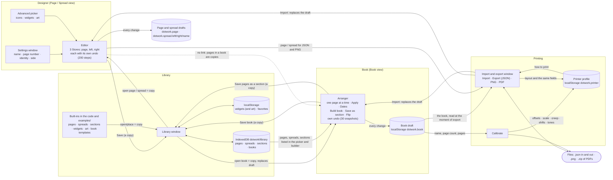

# Dotwork product map: how the app works today

This describes what the code does now (commit `25cf010`, the head of `main`), read from `src/`, not from the other docs or from
comments. Where the code and a doc disagree, the code wins and the disagreement is listed in **Things that disagree** at the end.
Anything I could not confirm from the code is marked **(unsure)**.

**Not covered:** the owner's example, `tests/fixtures/monthly-log-book.json`, was not in the repository (not on `main`, not on any
branch) when this was written, so nothing here was checked against it. The three symptoms the owner described are explained
from the code only, as the ways the code *can* produce them; see **The owner's monthly log book**.

## 1. The parts, in one picture

The one rule that holds everywhere: **nothing refers to anything else; everything is copied.** A page in a book is a copy of the
design it was chosen from. A spread holds two copies. A section holds copies. A recipe holds whole copies of its sections. A widget
placed on a page becomes ordinary elements. The only references in the app are Library ids (favorites, and the "Bottom book" choice in
the PDF tab) and the names of built-ins.

## 2. Things the app stores

| Thing | What it holds | Where it is kept | How it refers to others |
|---|---|---|---|
| **Page** (`dotwork-page`, version 2) | `name`, `identity` (the header text, may hold tokens), `page_number` (default on), `side` (`left` / `right` / `either`), the 27 × 44 grid, `elements[]` (pattern, shade, box, rule, checkboxes, text, sequence, art; each may carry a `group` id). `src/format/types.ts` | Draft: `dotwork.page`. Library: kind `page`. Inside spreads, books, sections, recipes. | Copy everywhere. |
| **Spread** (`dotwork-spread`, v2) | `name`, a `left` page and a `right` page (each must carry the matching `side`). `src/format/spread.ts` | Draft: *three keys*, `dotwork.spread.left`, `dotwork.spread.right` and `dotwork.spread.name`; the spread object is only built when needed (`currentSpread()` in `main.ts`). Library: kind `spread`. | Two embedded copies. |
| **Book** (`dotwork-book`, v1) | `name`, `page_count` (multiple of 4, 4–400), `page_numbers`, `print: { signatures }`, `pages[]` (page or `null`, entry *i* is page *i*+1, each turned to face its slot), optional `dates[]` (parallel to `pages`), `cover` (`front` = inside front, `back` = inside back, optional `outside_front`, `outside_back`), optional `recipe`. `src/book/book.ts` | Draft: `dotwork.book`. Library: kind `book`. | Embedded copies of every page, cover, and (in the recipe) every section. |
| **Section** (`dotwork-section`, v1) | `name`, `pages[]` (page or `null`), `days[]` (each page's date as whole days after the first dated page, or `null`), `weekday` of the first dated page, `move` (`none` / `day` / `week` / `month`: how dates shift per repeat), `left` (began on a left page). `src/book/sections.ts` | Library: kind `section`. Built-ins in code (`src/builtin/sections.ts`). Also inside every recipe step. | Embedded page copies. |
| **Recipe** | `month` (`YYYY-MM`), optional `gap` page (Notes when absent), `steps[]`: `{ section (a full copy), repeat: times n / weeks (month?, only_in_month) / fill, start? }`. `src/book/sections.ts`, `src/book/build.ts` | Inside the book (`book.recipe`), so in the draft, in Library books and in exported JSON. The *window's* working copy is memory only until **Generate book**. | Embedded section copies. |
| **Widget** | `{ id, name, elements[] }`, positions relative to its top-left. `src/widgets.ts` | `localStorage` `dotwork.widgets` (not the Library's IndexedDB). Built-ins from `examples/widgets/*.json` (`src/builtin/widgets.ts`). | Placing it adds ordinary copies; no link back. |
| **Art** | A widget holding one `art` element (an imported SVG: shapes and colors). `src/art/` | Same as widgets: `dotwork.widgets`. Built-ins from `examples/art/*.svg` plus presets. | Same. |
| **Library entry** | `{ id (uuid), kind, name, updated, data }`; `data.name` is forced equal to `name`. `src/library/library.ts` | IndexedDB database `dotwork`, store `library` (`src/library/idb.ts`). With no IndexedDB (`typeof indexedDB === 'undefined'`) it silently falls back to memory and is lost on reload. | Saving and opening are `structuredClone` copies. Saving over an existing name (same kind) replaces it after a confirm. |
| **Library backup** (`dotwork-library`, v1) | Every Library entry. | A downloaded file (**Back up library** / **Restore backup**). | Items are replaced by id on restore. **Does not include widgets, art or favorites** (they are in `localStorage`, not the Library store). |
| **Printer profile** | creep per sheet, fore-edge shift, cover shift, target margin, the four tones, `sheet_layout`, and per layout: front/back offsets, back rotation, x/y scale, line weight. `src/printer.ts`, `src/book/impose.ts` | `localStorage` `dotwork.printer`. Loaded once at start-up into a module variable in `main.ts`. Defaults (`DEFAULT_PRINT`) are the owner's printer. | Never in a book. `summary.txt` and calibration pages record the values used. |
| **Drafts** | The working copy of a page, the two spread pages, the spread name, and the book. | `localStorage` keys above, written on every change (no debounce). A draft that no longer passes the reader is copied to `<key>.bad.<time>` and offered as a download; it is never overwritten. `src/drafts.ts` | n/a |
| **Favorites** | Starred Library item ids. | `localStorage` `dotwork.favorites`. | By Library id; built-ins by name (`example:<page name>`, `template:<id>` …). |
| **Book templates** | Functions that build a whole book from a few numbers (year, month, first and last week). | Code only (`src/builtin/templates.ts`). Not saved; the result is just a book. | Output is a copy. |
| **View settings** | `dotwork.view` (page / spread / book), `dotwork.book.spreads` (one page or two), `dotwork.book.picker-tab`, `dotwork.book.flip-ms`. | `localStorage`. | n/a |
| **Memory only** (lost on reload) | Undo stacks, selection, hidden/locked layers, current tool and mode, which spread page is active, the Book view's current page, every window's unsaved choices (PDF checkboxes, PNG resolution, "Bottom book", Calibrate readings, Dates window, builder working recipe). | | |

**Files the app makes:** page / spread / book JSON, PNG (page or spread), and a zip of PDFs
(`<book>-print.zip`: `pages.pdf`, `cover-outside.pdf`, `cover-inside.pdf`, per-signature `print-first.pdf` / `print-second.pdf`
(and `print-duplex.pdf` for two-up), `preview.png`, `summary.txt`, `book.json`, and `error.txt` only on a problem). Calibration
downloads (`calibration-sheet.pdf`, a creep-test zip) also carry `book.json`.

## 3. Every screen, window and menu

Top bar: **Page ▾** (Page, Spread, Book, Settings…), **Edit ▾** (Edit, Preview, Library…, New), **Export**, Undo, Redo, Help.
Page/Spread views also have the bottom tool bar (Select, Draw, Advanced) and the properties drawer / layers.

| Screen | Reads | Writes | When it saves |
|---|---|---|---|
| **Page view** (editor) | `dotwork.page` at start; Store | Store → `dotwork.page` | On every committed change (`persist()` in `main.ts`). Typing in a properties text field commits after a pause or on blur (`panel.ts`). Undo history, selection, hidden/locked are not saved. |
| **Spread view** | `dotwork.spread.*` | The active page's Store → `dotwork.spread.left/right`; spread name → `dotwork.spread.name` (on each keystroke in Settings) | Same. Left and right each have their own undo. |
| **Properties / Layers** (drawer or side panel) | The selected element(s) | Store (undoable) | Same as above. |
| **Advanced** (sequence, icon, checkboxes, widgets, art) | Library-side widgets and built-ins | Arms a tool on all three Stores; **More → Save as widget** writes `dotwork.widgets` | Widgets: immediately. |
| **Settings…** | Page: `store.page`. Spread: spread name + both pages. Book: the book | Page/spread: Store commits (undoable, coalesced per field). Book: `arranger.edit()` → book draft | On each input event (`oninput`), not on Done. Book name edits are one undo step each keystroke (30-step limit). |
| **Library…** (window) | IndexedDB entries; built-ins; `dotwork.widgets`; favorites | **Save page / spread / left / right / book** → IndexedDB; rename, duplicate, delete → IndexedDB; star → favorites; Import SVG art → `dotwork.widgets`; Back up / Restore → file | Only when a button is pressed. Opening something replaces the matching draft *immediately* (see Saving). Tabs: Pages, Spreads, Sections, Art, Books (templates + saved books), Widgets, Favorites. It opens on Pages (or Books in the Book view). |
| **Book view** (Arranger) | `dotwork.book` (loaded the first time the view is shown); Library pages / spreads / sections (refreshed when shown and when the Library closes); built-in pages and spreads; printer profile (only to warn) | The book, via `edit()` → `dotwork.book`; **Save pages as a section** → Library | After every change, one undo snapshot each. Slot, Spreads toggle: `dotwork.book.spreads` for the toggle, the slot is memory only. |
| **Choose design…** (picker) | Blank, saved pages, built-in pages; for left slots with a page after them also spreads | `setSlot` / `fillSlots` on the book | On choosing. |
| **Apply to more pages…** | The design on the current page (or its facing page) | `applyDesign` over a range, or every left / right page | On Apply. |
| **Dates…** (More menu) | Book dates; the current page; today's local date only when the book has no dates | `book.dates` (and nothing else) | On **Set dates** / **Clear dates**. Details in Dates. |
| **Build book…** (the builder) | `book.recipe`, else the month of the first dated page, else today; saved + built-in sections; saved + built-in pages (for the gap page) | Only on **Generate book**: every interior page, every date, `book.recipe`. Covers are not touched. | One undo step. Cancel discards the working recipe. |
| **Save pages as a section…** | A page range of the book and its dates | Library section | On **Save section**. |
| **Flip through** | The book (read-only). Speed from `dotwork.book.flip-ms` | Speed | On slider input. |
| **Import and export** window (**Export** button) | See below | See below | See below. Opens on Export; opens on PDF in the Book view. |
| ↳ **Import** | A chosen `.json` | Replaces the page (undoable), spread (undoable), or book (not undoable, no confirm). A library backup is refused with a pointer to Restore backup. Version-1 pages are converted. | Immediately. |
| ↳ **Export** | The current page / spread / book **at the moment Download is pressed** (`jsonToExport()` in `main.ts` runs again on click) | A `.json` download | On Download. |
| ↳ **PNG** | The page (or the spread being edited) | A `.png` (150 / 300 / 600 dpi). Not in the Book view. Prints with sample values: the sample date (Mon Oct 26 2026) for tokens and a sample page number "47" (`SAMPLE_DATE`, `SAMPLE_PAGE_NUMBER`) | On Download. |
| ↳ **PDF** | The book, printer profile, Library books (Bottom book) | A zip. Its fields write the printer profile (`dotwork.printer`) and the book's signatures (book draft) as they are changed | Fields: on change. Files: on Download. |
| **Calibrate** (from the PDF tab) | Book (name, page count; included as `book.json` in downloads), printer profile | The printer profile only, each time a field or a "Use" button changes it. Never the book. | Immediately; typed readings are memory only. Closing returns to the PDF tab. |
| **Help mode** | `src/help.ts` (one entry per `data-help` key, touch and desktop text) | Nothing | n/a |
| **Notices** | Problems (bad draft, can't export, can't keep a draft) | Nothing; a bad-draft notice is sticky until one of its buttons is used | n/a |

Keyboard shortcuts (page and spread views only; the Book view has none except ←/→ for the page): V, A, P, S, B, R, C, T, Ctrl/Cmd+Z/Y/D, arrows, Delete, Escape.

## 4. Dates end to end

**Where a date can come from.** A date is a `YYYY-MM-DD` string. There are six sources:

1. **Dates… window** (`arranger.ts` `openDates` / `renderDates`, math in `plan.ts`). *Each page is one week*: you give a year and a week number; every page in the range gets a Sunday, seven days apart (`weekStart`). *Each page is one day*: you give a start date; pages are consecutive days. The range is "From page – To page", prefilled with the current page to the end of the run of pages that share its design.
2. **Book builder** (`build.ts` `planSteps` / `applyBuild`). For each step, each repeat's first date plus the section's `days[i]` for page *i*. Where the first date comes from depends on the step (below). Replaces every interior page's date.
3. **Library book / template / import:** a book arrives with its `dates` as stored. Templates (`templates.ts`) compute literal dates from year/month (or year/first week).
4. **Defaults used when nothing else is known:** `todayIso()` (local date, never UTC) starts the Dates window for a book with no dates and is the builder's month for a book with no recipe and no dates; hard-coded `2026-01` / week 1 in the Dates window and a `2026-01` recipe are overwritten the moment either window opens (`arranger.ts` lines 102 and 113, 528–540, 662).
5. **The sample date** `2026-10-26` (`SAMPLE_DATE`): not a book date; it is what every editor view, Library thumbnail, PNG, and the Page view's Preview show tokens as.
6. Nothing else. There is no "date of the book" and no setting that moves all dates at once.

**Where it is stored.** `book.dates[]`, one entry per interior page (`null` = undated), absent when no page has one. Covers have no date. `book.recipe.month` and each step's `start` / `repeat.month` are separate stored values the builder reads next time; they are *not* kept in step with `dates` (see Things that disagree).

**How tokens read it.** `{weekday} {month} {monthname} {day} {year} {week} {months}` (`src/format/tokens.ts`, `dates.ts`). Every print/preview path calls `expandFor(dateOf(book, slot))`: a dated page fills its tokens from its date; an undated page and every cover print them **blank** (`blankTokens`), so they can be written in by hand. The editor, Library thumbnails and PNGs use the sample date instead. Weeks run Sunday–Saturday and week 1 holds January 1.

**What an offset means.** `{name+N}` / `{name-N}` shifts the **date by N days**, then reads the token. It is a *day* offset for every token: `{day+1}` is tomorrow's day number, and **`{month+1}` is the month of tomorrow**, not next month (so it equals `{month}` except on the last day of a month). `{month+6}` in the built-in weekly reflection (`WEEK {week}  {month} {day}-{month+6} {day+6}`) works because the week's last day is six days on. There is no month offset. `{months}` is a separate token: the month, or "NOV / DEC" when the 7 days from the date reach the next month. A page "stands for a day" (`pageSpan`) if it uses `{weekday}` or `{day}` with only 0 offsets and no `{months}`; otherwise it stands for a week. That decides what the builder drops (`only_in_month`) and what **Save as section** guesses.

**What happens when…**

- **Pages move.** There is no UI to move or swap pages (`movePage` / `swapPages` in `book.ts` are exercised only by tests). **Apply to more pages** and **Choose design** replace the design in a slot; the slot keeps its date, unless the new design uses no date tokens, in which case the date is cleared (`setSlot`). A date is never added by choosing a design.
- **The book is resized** (Settings → Pages): `pages` and `dates` are cut or padded with `null`; the recipe is untouched, even though it was built for another page count (the next **Generate** uses the new count).
- **Rebuild** (Generate book): every interior page and date is replaced; covers are not touched; `book.recipe` is replaced by the window's recipe (its month, gap, steps).
- **A step is repeated:**
  - *Each week of a month* (`weeks`): the first repeat starts on the section's `weekday` on or before the 1st of the step's month (else the recipe's month); each next repeat is exactly 7 days later until a start passes the month's last day. The section's `move` is **ignored**. With "only days in the month" day pages dated outside the month are left out (week pages are kept).
  - *A number of times* (`times`) and *Fill what's left* (`fill`): the first repeat starts on the step's `start`, else the 1st of the **recipe's** month. Repeat *k* moves by the **section's** `move`: `none` repeats the same dates every time, `day` +k days, `week` +7k days, `month` +k calendar months (day of month kept, clamped).
  - Each repeat starts on the side of the spine the section started on; a gap page is inserted otherwise.
- **A section is saved from the book** (`sectionFrom`): dates become `days` relative to the first dated page; `weekday` is that page's weekday; `move` is the window's choice, prefilled by `guessMove` (any run with more than one distinct date is guessed as `week`, whatever the spacing); a run with no dates is saved with `move: none`.
- **Imported:** `readBook` checks `dates` has `page_count` entries, each a real day or `null`. The recipe is checked for shape only (month format, repeat kinds, at most one `fill`); nothing checks that `recipe.month` agrees with `dates`.
- **Library "Open" of a book, or a template:** the book's dates are copied as they are.

### The owner's monthly log book (from the code only; the file was not available)

I could not open `monthly-log-book.json`, so I cannot say which of these happened to it. These are the places in the code that
produce each symptom.

1. **Month 2027-11.** `book.recipe.month` can only come from: the Month and Year fields in the builder (Year accepts 1900–2200 and the number box has up/down arrows, so one tap of ▲ on 2026 gives 2027); the builder's starting value when the book has no recipe, which is the month of the **first dated page** (`arranger.ts:658–662`), else today; or a step's own *Other month* box. Because a book that already has a recipe opens the builder on `recipe.month`, **not** on the dates actually on its pages, a book's recipe month and its page dates can differ with nothing noticing. If the first dated page was in 2027-11 (for instance dated with the Dates window's *Year* field), the builder offers 2027-11. Which of these it was **(unsure)**: it needs the file's `recipe.month`, `dates[0]` and any step `start`.
2. **Daily pages a week apart.** The Dates window opens in *Each page is one week* (`dating.mode` starts as `'week'`, `arranger.ts:113`) and only switches to *one day* when the current page has **no** date **and** the book already has some (`:530`). So on a book with no dates, or on a page that is already dated, pressing **Set dates** on a run of daily pages gives them Sundays seven days apart. In week mode a page that already has a Tuesday date is also snapped to its Sunday. (The same result comes from a saved section with `move: week` whose daily pages were dated a week apart.)
3. **Every week section has the same dates.** Adding a step from the builder's **Add a step** list creates `{ repeat: { kind: 'times', count: 1 } }` with **no `start`** (`arranger.ts:795`, and `:698` when a step's repeat is switched back to *A number of times*). Every `times` step with no `start` starts on the 1st of `recipe.month`. So several steps, each adding a week section once, all get the same dates. A `times` step with count > 1 on a section whose `move` is `none` repeats identical dates too. Only the *Each week of a month* repeat spaces the weeks out by itself. Whether the file has several `times ×1` steps or one `none`-move section **(unsure)**.

## 5. Saving and export

- **Autosave.** There is no Save button for work in progress. Page, spread pages, spread name and book are written to `localStorage` on every change. A draft that breaks the format is *not* written (the last good draft stays) and a notice says why; one that can't be read on start-up is backed up under `<key>.bad.<time>`, reported, and the app starts empty.
- **Library save** is explicit: a button per thing (page; spread, left page, right page; book), saved under the name set in Settings. The same name and kind replaces the old item after a confirm. Names are trimmed; an empty name becomes `Untitled`. A built-in's name is reserved and refused (`checkName`). The editor's own copy is untouched: there is no link between the draft and the saved item, and no "unsaved changes" marker.
- **Opening** from the Library or a file copies it into the draft. For a page or spread this is undoable (the Store keeps the old one). For a **book** it replaces `dotwork.book` at once, clears the book's undo and asks nothing (`main.ts` `openBook`). **New** asks first only for a book with designed pages, and a new book cannot be undone; the help text for New says Undo brings the old one back, which is true for pages and spreads only.
- **Export JSON** (Export tab) exports the live object for the current view: the page, the spread built from the two spread pages and the spread name, or the book (`arranger.current`), checked against the format first. It is *not* the file that was opened; the new test `tests/e2e/navigation.e2e.ts` ("Export saves the book as it is now…") pins that. It exports the **view you are in**: in Page view you get the page even if a book is open in the background.
- **Built-ins vs copies.** Built-in pages, spreads, sections, widgets, art and templates are code or `examples/` files and cannot be changed or overwritten. Opening or placing one makes a copy named "<name> copy"; a template builds a fresh book. Built-in page / spread / section names are reserved for saved items.
- **Names.** Defaults: page `Untitled`, spread `Untitled spread` (its pages `Left page` / `Right page`), book `Untitled book`, saved sections `Untitled`. File names come from the name via `slug` (fallback `page`, `spread`, `book`): `untitled.json`, `untitled-book.json`, `untitled-book-print.zip`. Saving "Left page" from a spread uses that name unless it was renamed, so two spreads' left pages collide in the Library.
- **On reload.** Drafts, the view, the widgets, the printer profile, favorites and the Library come back. Lost: undo and redo, selection, hidden / locked, tool and mode, the active spread page (back to left), the Book view's page (back to page 1), all window choices. The printer profile is read once at start-up; a second tab would overwrite it with its own on its next edit (last write wins) **(unsure: not tested)**.
- **Printing a book** uses the book as it is and the printer profile as it is at that moment; the zip's `book.json` is that same object, `summary.txt` the same settings.

## 6. Covers

The book has four cover pages: **inside front** (left page, `cover.front`), **inside back** (right page, `cover.back`), **outside front** (right, `cover.outside_front`), **outside back** (left, `cover.outside_back`). They are ordinary pages: no page number, no date, tokens print blank.

- **Generated:** only by a **book template**, and only the two *inside* covers: the monthly journal gets a tracker cover for the month and a page index (`monthlyTracker`, `monthlyPageIndex`); the year planner a goals cover and a year index; plain books a purpose cover and a plain index. These are built from the answers (year, month) as **literal text and drawings**, not tokens, and are never touched again by **Build book** (which replaces interior pages only) or by changing a date. The outside covers are never generated.
- **Typed or chosen in:** everything else. The outside covers, and any inside cover you want different, are chosen with **Choose design…** after stepping to the cover with ‹ / › (the outside front cover comes before the inside front cover, the outside back after the inside back), or drawn in the editor and saved to the Library first. **Apply to more pages** never reaches a cover (`scopeSlots`, `plan.ts:6`); a spread chosen on the first left slot can fill the inside front cover and page 1 (`fillSlots` allows slots 0 to page_count+1).
- **Printed:** `cover-outside.pdf` (outside back | outside front, first pass) and `cover-inside.pdf` (inside front | inside back, second pass), single-sided, with the cover fore-edge shift. Missing outside covers print blank.

## 7. Things that disagree: inconsistencies, duplication, dead code, stale docs

**Behaviour that contradicts itself or its own words**

1. **Recipe month vs. dates.** `openBuild` prefers `book.recipe.month` over the dates on the pages (`arranger.ts:662`); the Dates window and any later change never update the recipe. Nothing reports the mismatch. The month a book "is" is stored in two places.
2. **A newly added step has no `start`.** `arranger.ts:795` adds `times ×1`; all such steps start on the same day (see the owner's example 3).
3. **Dates window defaults to weeks.** `arranger.ts:113` and `:530`; daily pages get a week apart on first use (example 2).
4. **`weeks` ignores `move`; `times` and `fill` honour it.** The section list says "dates a week later" for a section, which describes only the `times`/`fill` behaviour.
5. **`guessMove` guesses `week` for any run with two or more distinct dates** (e.g. 30 daily pages in November), where `month` would be the repeat people mean (`build.ts:44`).
6. **"New" help says Undo brings the old one back**; for a book it can't (`help.ts` `new`, `main.ts:488–500`; `Arranger.setBook` clears the undo stack).
7. **Open / Import of a book replaces the draft with no confirm and no undo**, while Import's own text says "Undo takes a page back" for pages only.
8. **PNG shows sample values**: sample date 2026-10-26 and page number "47" (`png.ts` → `render.ts` defaults), unlike every PDF path, which fills from the book. A PNG of a dated book page is not what prints.
9. **"Back up library" leaves out widgets, art and favorites**, although the Library window lists them on tabs (`library.ts` `exportAll`, `widgets.ts`, `favorites.ts`).
10. **Widgets and art are in `localStorage`**, the Library's pages and books in IndexedDB: two stores, two failure modes (a large imported SVG can hit the localStorage quota; the failure is silent, "last for this visit", `widgets.ts:changed`).
11. **IndexedDB missing → memory backend, silently** (`main.ts:93`): saves appear to work and vanish on reload.
12. **Per-page "Untitled" collision.** Saving any page named `Untitled` replaces the previous `Untitled` (after a confirm); saving a spread's left page is named `Left page` unless renamed.
13. **Template defaults read the clock once at load** (`templates.ts:55`: `new Date().getFullYear()` and `getMonth()`), while built-in sample pages are fixed to 2026-10 (`builtin/library.ts:25`) and the editor's token sample is fixed to 2026-10-26 (`tokens.ts:8`).
14. **Template books hold literal text** where the builder's books hold tokens (a reflection's identity `WEEK 44  OCT 26-31` vs `WEEK {week}  {month} {day}-{month+6} {day+6}`); a template book cannot be re-dated.

**Dead code (nothing in the app uses it)**

- `swapPages`, `movePage`, `carry` (`book.ts:174–190`): tested, but there is no way to move or swap pages in the UI, so the "dates travel with their page" rule in the docs has no user-visible path.
- `findBuiltinSection` (`builtin/sections.ts:48`), `monthSpan` (`builtin/calendar.ts:34`): unused, not tested.
- Exported but used only by tests: `markZone` (`book/alignment.ts`), `backPoint`, `backRegion` (`print/sheets.ts`), `calibrationPages` (`print/calibrate.ts`), `moveElement` (`geometry.ts`), `itemValue` (`format/sequence.ts`), `TRIM_ZONE_MM` (`book/impose.ts`), `SAMPLE_DATE` outside `tokens.ts`.
- `fresh` in `LibraryHost.openBook(book, fresh?)` (`library/dialog.ts:40–41`, passed at `:272`): `main.ts openBook(next)` ignores it. Its doc ("takes the printer's saved print settings") is from before the printer profile.
- Version-1 page support: `format/v1.ts`, `validate-v1.ts`, `convert.ts`, and the `converted` flags through `readBook` / `readSpread` / the notices in `main.ts:540–557`. `CLAUDE.md` says not to add conversions; these predate it and are still wired in.
- Old-book tolerance: `readBook` ignores everything but `signatures` inside `print` (`book.ts:216`) so books from before the printer profile still open; `readPrinter` fills in `back_rotation_deg` and `line_weight_x_pct` for older profiles (`printer.ts:41–49`). Both are migrations under another name.

**Duplication**

- `isObject` is defined in seven files (`book/book.ts`, `book/sections.ts`, `library/library.ts`, `format/spread.ts`, `format/validate.ts`, `format/validate-v1.ts`, `format/art.ts`).
- `daysBetween`: `build.ts:15` and `plan.ts:136`, identical.
- "Today as a local `YYYY-MM-DD`": `dates.ts` `todayIso` and `print/settingstext.ts` `isoDay`.
- Month and weekday name tables: `dates.ts` (`MONTHS`, `MONTH_NAMES`, `WEEKDAYS`) and `builtin/calendar.ts` (`MONTH_ABBR`, `MONTH_NAMES`, `WEEKDAY_ABBR`).
- "A page from examples/pages, or the notes page": `example()` in both `builtin/templates.ts` and `builtin/sections.ts`.
- The `try { return localStorage } catch` wrapper is written out three times in `main.ts` (`:46`, `:90`, `:599`); `stored()` is in `main.ts:44` and `arranger.ts:39`.
- Two undo systems: `Store` (200 steps, coalescing, per page) and `Arranger` (30 JSON snapshots, whole book). The top-bar Undo is hidden in the Book view, which has its own button.
- A name lives twice in each Library item (`item.name`, `item.data.name`) and the draft page's name is set in Settings, not where it is saved.

**Stale docs and help text**

- `docs/book-format.md:20–22` shows `"recipe": { "month", "weekday", "section" }`, the shape before steps; the **Recipe** section below it is right.
- `docs/book-format.md` lists the two-up defaults as front -0.75 / -1.6 and back 0 / 1.1; `DEFAULT_PRINT` (`book/impose.ts`) is front -0.25 / -1.55 and back -0.4 / 1, scale y 101.01, rotation -0.183.
- `docs/book-format.md` says dates "travel with their page: moving or swapping pages moves their dates": no UI moves pages.
- `docs/library-format.md:3–4` says **Export library** / **Import library**; the buttons are **Back up library** / **Restore backup**. It also says version-1 pages are converted.
- `help.ts` entries `book-export` and `book-cover-shift` say `cover.pdf`; the files are `cover-outside.pdf` and `cover-inside.pdf`. `impose.ts:75` comment says the same.
- `help.ts` `new` (see 6 above).
- `CLAUDE.md` roadmap item 15 still names **Build by week**, which is now only a preset (`builtin/sections.ts:34`).
- `README.md:110` says "The current page autosaves"; the spread and book drafts autosave too. No doc lists the `localStorage` keys; §2 here is the only list.

## 8. Open questions

1. `tests/fixtures/monthly-log-book.json` is missing; the three explanations in §4 need it to be confirmed.
2. Should the recipe's month follow the dates (or the dates the recipe), and should a new step start where the previous one ended instead of on the 1st?
3. Should Dates open in *one day* mode unless the current page is a week page?
4. Should PNG fill tokens and the page number like the PDFs, or stay a sample?
5. Should "Back up library" also carry widgets, art and favorites?
6. Is there meant to be a way to move or swap pages in the Book view (the code and docs assume one)?
